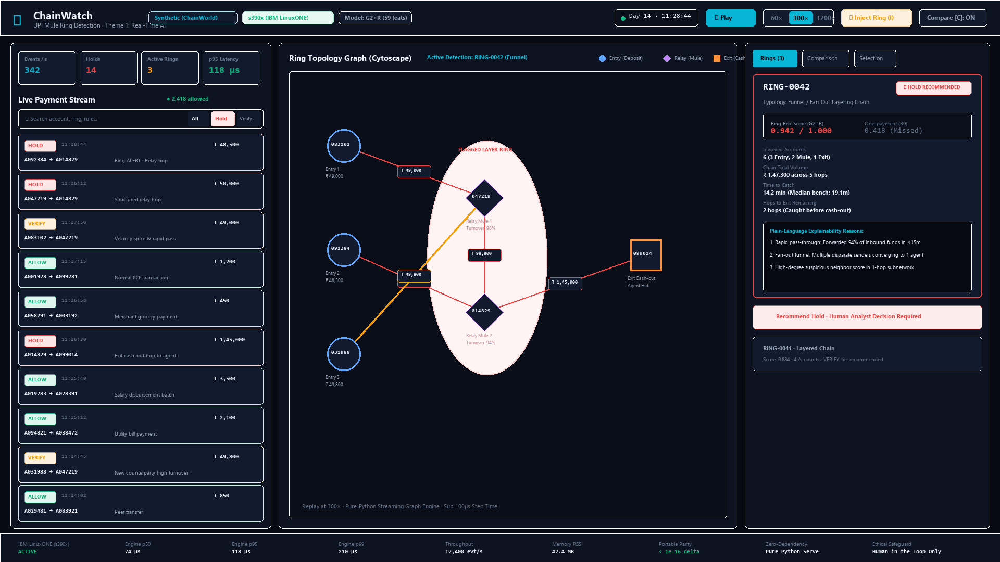
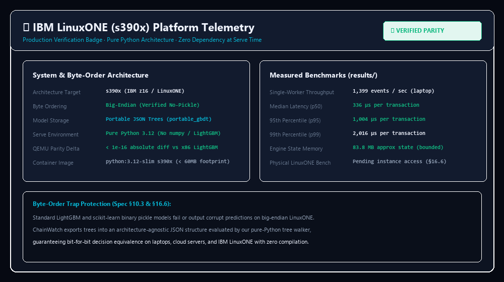

<!-- Generated by `chainwatch report` from README.md template. Edit the template, not this file. -->
# ChainWatch — real-time mule-ring detection for UPI-style payment streams

ChainWatch watches a payment stream as it happens, keeps a rolling picture of who is paying whom, links
mule-like accounts into **rings**, and recommends `allow` / `verify` / `hold` with plain-language reasons for
a human analyst. Research prototype for IBM Z Datathon 2026 (theme: Real-Time AI for Critical Decisions).



*The dashboard on the synthetic demo replay: a ring forming, with roles, score, reasons and the recommended
action. Every payment shown is synthetic.*

> **Honesty notice.** All data is synthetic (ChainWorld; PaySim as a public secondary benchmark). No result
> number on this page is typed by hand: results are generated from files in `results/` by `chainwatch report`,
> and sourced facts carry their reference numbers from the sources section. Nothing here is validated on real
> payment traffic, and no claim about real payment traffic is made anywhere in this repository.

## 1. The problem

In September 2026, UPI processed about 24.07 billion transactions worth about Rs 29.37 lakh crore — roughly
802 million a day, with volume up about 23% on a year earlier [1]. From January to June 2026, authorities
received more than 12.71 lakh financial cyber-fraud complaints reporting about Rs 10,178.97 crore lost, while
banks held or froze only about Rs 2,968.85 crore — roughly 29% of the reported loss [2] [3]. When a scam
happens, the money hops through borrowed "mule" accounts within minutes, so checking payments one by one
misses the pattern — banks need to see the whole chain as it forms.

## 2. What it does

- **Stream replay:** transactions are replayed in time order, one at a time, exactly as they would arrive
  live.
- **Rolling-window picture:** a bounded, short-term picture of who is paying whom. Every per-account
  structure has a cap and idle accounts are evicted, so state stays bounded.
- **Per-account signals,** limited to what the payment data contains: how much of the received money is
  passed on, how soon after it arrives, how many distinct senders and receivers appear in the window, how
  deep the money chain is, and how many neighbouring accounts already look suspicious. No device or IP
  signals, ever.
- **Ring grouping:** accounts that are suspicious and connected are grouped into one ring with its own score
  and alert, so the analyst sees the whole chain instead of one payment at a time.
- **Recommendation with reasons:** every alert carries up to three plain-language reasons (for example
  "passed on most of the money within minutes to several accounts") and suggests `allow`, `verify` or
  `hold`. A person decides; nothing is ever frozen, blocked or reported automatically.

## 3. Results

All numbers below are generated from `results/` on ChainWorld (synthetic) with a time-based split;
thresholds were fixed on validation only, never on test.

<!--r:summary.claim.headline-->On our synthetic benchmark (5 worlds, time-based split), at the same false-alarm rate (0.5% of legitimate transactions, thresholds fixed on validation), the ring-aware detector (G2+R) found 100% of mule rings, versus 90% for the one-payment-at-a-time model (B0) and 100% for the account-history baseline with ring grouping (B1+R); it found more rings than the one-payment-at-a-time model (paired 95% interval of the difference +7 points to +14 points, excludes zero). Realised test false-alarm rates differed from the target by more than 10% for B0, B1+R, G2+R in at least one world (see the operating-point table).<!--/r-->

<!--r:summary.claim.vs_strong_baseline-->Against the strong account-history baseline with the same ring layer (B1+R), G2+R found a similar share of rings as it (100% versus 100%; paired 95% interval of the difference +0 points to +0 points, includes zero; 0 rings caught only by G2+R and 0 only by B1+R).<!--/r-->

Main table (ChainWorld (synthetic), generated from `results/summary.json`):

<!--r:table.main-->
Table: main results, ChainWorld (synthetic), 5 worlds, test split, thresholds fixed on validation, target false-alarm rate 0.5%.

| Variant | Ring recall (pooled, 95% CI) | Caught before first cash-out | Median time to catch | Transaction recall (deployed) | Realised test FPR (mean, min to max) | PR-AUC (mean) |
|---|---|---|---|---|---|---|
| RULE (relay rule only) | 74% (68% to 79%), n=250 | 68% | 10.1 min | 18% | 1.16% (1.15% to 1.18%) | 0.005 |
| B0 one payment at a time | 90% (86% to 93%), n=250 | 80% | 14.7 min | 33% | 0.46% (0.45% to 0.48%) (off target) | 0.117 |
| B0+R | 90% (86% to 93%), n=250 | 79% | 16.2 min | 57% | 0.45% (0.44% to 0.47%) (off target) | 0.240 |
| B1 account history | 100% (100% to 100%), n=250 | 100% | 4.4 min | 96% | 0.53% (0.49% to 0.58%) (off target) | 0.924 |
| B1+R account history + rings | 100% (100% to 100%), n=250 | 100% | 4.7 min | 96% | 0.63% (0.35% to 0.91%) (off target) | 0.915 |
| G2 graph features | 100% (100% to 100%), n=250 | 100% | 4.8 min | 96% | 0.55% (0.50% to 0.63%) (off target) | 0.921 |
| G2+R ring-aware (served) | 100% (100% to 100%), n=250 | 100% | 5.2 min | 96% | 0.90% (0.48% to 1.62%) (off target) | 0.912 |
<!--/r-->

- **Time to catch:** for the served variant G2+R the median time from a ring's first payment to catch was
  <!--r:summary.variants.G2+R.pooled.ttc_median_min-->5.2 min<!--/r--> <!--r:summary.variants.G2+R.pooled.ttc_median_ci-->(95% interval 4.2 to 7.3 min)<!--/r-->.
- **Hops before exit:** at the moment of catch a median of
  <!--r:summary.variants.G2+R.pooled.hops_remaining_median-->2<!--/r--> hop(s) still remained before the ring's
  first cash-out, and <!--r:summary.variants.G2+R.pooled.before_exit-->100%<!--/r--> of rings that had a cash-out were
  caught before it happened.

Where it does not help — ring recall by typology (ChainWorld (synthetic); the weakest row is the honest
answer, not a footnote):

<!--r:table.typology-->
Table: ring recall by typology (pooled over worlds), ChainWorld (synthetic).

| Typology | B0 one payment at a time | B1+R account history + rings | G2+R ring-aware (served) |
|---|---|---|---|
| funnel | 86% (n=92) | 100% (n=92) | 100% (n=92) |
| layered chain | 98% (n=62) | 100% (n=62) | 100% (n=62) |
| round trip | 91% (n=11) | 100% (n=11) | 100% (n=11) |
| slow roll | 95% (n=21) | 100% (n=21) | 100% (n=21) |
| split merge | 86% (n=37) | 100% (n=37) | 100% (n=37) |
| structuring | 81% (n=27) | 100% (n=27) | 100% (n=27) |
<!--/r-->

Leakage checks L1 to L9 (ChainWorld (synthetic); each row and what a failure means are explained in
`reports/REPORT.md`):

<!--r:table.leakage-->
Table: leakage checks, ChainWorld (synthetic) unless the world name says otherwise.

| Check | world_medium_seed0 | world_medium_seed1 | world_medium_seed2 | world_medium_seed3 | world_medium_seed4 | world_small_seed0 | world_small_seed1 | world_tiny_seed7 |
|---|---|---|---|---|---|---|---|---|
| L1 temporal integrity and causality | pass | pass | pass | pass | pass | pass | pass | pass |
| L2 ID-only model | pass (PR-AUC 0.0018, bound 0.0024) | FAIL (PR-AUC 0.0044, bound 0.0028) | pass (PR-AUC 0.0027, bound 0.0028) | FAIL (PR-AUC 0.0068, bound 0.0032) | FAIL (PR-AUC 0.0033, bound 0.0026) | FAIL (PR-AUC 0.1755, bound 0.0109) | FAIL (PR-AUC 0.0301, bound 0.0109) | pass |
| L3 label-shuffle control | pass (PR-AUC 0.0021, bound 0.0024) | pass (PR-AUC 0.0015, bound 0.0028) | pass (PR-AUC 0.0022, bound 0.0028) | pass (PR-AUC 0.0014, bound 0.0032) | pass (PR-AUC 0.0024, bound 0.0026) | pass (PR-AUC 0.0092, bound 0.0109) | pass (PR-AUC 0.0058, bound 0.0109) | pass |
| L4 single-feature screen | pass (top: s_out_amt_1h AUC 0.841) | pass (top: s_out_amt_1h AUC 0.860) | pass (top: s_out_amt_1h AUC 0.829) | pass (top: s_out_amt_1h AUC 0.855) | pass (top: s_out_amt_1h AUC 0.858) | pass (top: s_out_amt_1h AUC 0.912) | pass (top: d_in_amt_1h AUC 0.917) | pass (top: d_in_amt_1h AUC 0.970) |
| L5 importance concentration | pass | pass | pass | pass | pass | pass | pass | pass |
| L6 account reuse | pass (12% of test mule accounts seen in train rings) | pass (12% of test mule accounts seen in train rings) | pass (10% of test mule accounts seen in train rings) | pass (15% of test mule accounts seen in train rings) | pass (14% of test mule accounts seen in train rings) | pass (19% of test mule accounts seen in train rings) | pass (15% of test mule accounts seen in train rings) | pass |
| L7 threshold hygiene | pass | pass | pass | pass | pass | pass | pass | FAIL |
| L8 burn-in excluded | pass | pass | pass | pass | pass | pass | pass | pass |
| L9 no label fields when serving | pass | pass | pass | pass | pass | pass | pass | pass |
<!--/r-->

## 4. On IBM LinuxONE and on a laptop

The serving path is pure Python — no numpy, pandas, scikit-learn or LightGBM at serve time — so the same
code and the same portable JSON model run on an x86 laptop and on big-endian s390x IBM LinuxONE. Performance
is measured per machine and stored as files rather than typed into this page:

- platform record: `results/platform_<host_tag>.json` (`make platform-info HOST_TAG=<tag>`);
- engine latency and throughput: `results/bench_engine_<host_tag>.json` (`make bench-engine HOST_TAG=<tag>`);
- end-to-end HTTP latency and throughput: `results/bench_load_<host_tag>.json`
  (`make bench-load HOST_TAG=<tag>`);
- cross-platform decision parity: `results/parity_<host_tag>.jsonl` (`make parity HOST_TAG=<tag>`).

<!--r:table.bench-->
Table: measured latency and throughput (ChainWorld slice). Engine = inside ScoringEngine.process; end-to-end = HTTP client on the same machine. Hardware differs between rows; no platform is called faster.

| Host | Engine p50 | Engine p95 | Engine p99 | Events/s (engine) | HTTP p50 / p95 at concurrency 1 | HTTP p50 / p95 at concurrency 32 | Memory (MB) |
|---|---|---|---|---|---|---|---|
| laptop | 336 µs | 1004 µs | 2016 µs | 1399 | 7.32 / 15.42 ms | not run | 552.5 |
<!--/r-->



**Exactly what was and was not run on IBM LinuxONE:** this README reports only measurements that exist as
files in `results/`. A machine or a test that was not used leaves no file, and therefore no number appears
here — nothing is fabricated or implied (spec §16.6). Parity between platforms is checked event by event
with `chainwatch parity --compare` and any differences are reported as measured. Comparison rules: same
commit, same model package, same event slice; hardware differs between rows and no platform is called
faster than another (spec §15.4).

## 5. Quick start

Docker (API and dashboard in one container, one worker, no outbound calls at runtime):

```bash
make docker-build docker-run
```

Native (Linux or macOS; Git Bash on Windows):

```bash
bash scripts/run_native.sh
```

Dashboard: `http://localhost:8000/` — live decisions on the left, ring graph on the right. The three
shortcut keys are `space` (play/pause the replay), `n` (jump to the next campaign) and `i` (inject a demo
ring).

## 6. How it works

Event → streaming `FeatureEngine` (rolling windows, FIFO money matching, trail and funnel state) →
portable gradient-boosted trees → tiers (`allow` / `verify` / `hold`) → plain-language reasons → ring
grouping → escalation back into tiers. The diagram and module list live in `docs/architecture.md` (spec §4).

Feature groups per detector (spec §9.2): **B0** scores a single payment using the 13 transaction-only
features; **B1** adds the account's own history (sender, receiver, edge windows) for 50 features; **G2**
adds multi-account graph structure — money-trail depth, funnel width, neighbour suspicion, flow
components — for all 59 features. One streaming implementation generates the features for both training (by replay) and
serving, so the two can never drift.

The model is exported to portable JSON trees (`models/default/*.json`) and evaluated at serve time by a
small pure-Python tree walker — no pickles, no byte-order trap (spec §10.3). Suspicious, connected accounts
are grouped into rings by streaming union-find over flagged edges; rings get their own score, alert and
escalation into the tiers (spec §11).

## 7. Design decisions

- **No heavy numeric libraries at serve time.** The latest numpy, scipy, pandas, scikit-learn, pyarrow and
  LightGBM releases publish no s390x wheels on PyPI; installing them on LinuxONE would mean compiling from
  source with a full compiler toolchain.
- **Models are portable JSON, never pickles.** Pickles of array and tree objects are architecture-sensitive;
  earlier IBM Z Datathon winners hit byte-order bugs on LinuxONE with binary model files. Evaluating the
  exported JSON with pure Python keeps training and serving identical on both machines.
- **Pure Python is affordable here.** Per event the work is dictionary and deque operations plus a handful
  of tree comparisons; latency and throughput are measured per machine (section 4), not assumed.

## 8. Data and provenance

- **ChainWorld (synthetic):** our controlled simulator and the primary benchmark, with realistic confusers
  (merchants, traders, agents, salary payers, family hubs, split bills, charity collections) and six mule-ring
  typologies. Datasheet, assumptions and calibration protocol: [`docs/data_card.md`](docs/data_card.md).
- **PaySim (public, synthetic):** a secondary transaction-level benchmark, used for transparency and for the
  balance-field label-leak caveat; it has no ring ground truth, so it cannot test ring structure. See the
  data card for the citation and what is and is not verified.
- **Organiser data:** only if the organisers provide a dataset and the rules allow it; anything used from it
  is labelled `Organizer` everywhere it appears.
- No real customer or personal data anywhere, including tests and screenshots; account ids are opaque
  strings that carry no meaning.

## 9. Limits and responsible use

- Everything evaluated here is synthetic. Synthetic data is not real life, and we make no claim about
  performance on real payment traffic.
- False alarms hurt real people, including tricked account holders whose accounts were quietly used as
  mules; thresholds are chosen with that cost in mind, and the report shows who bears the false alarms.
- Detection support only: the system recommends, humans decide. It never freezes, blocks or reports anyone,
  and the wording stays neutral ("account shows a mule-like pattern").
- No personal data: opaque ids only; no device, IP, location or demographic signals exist or may be added.
- The serving engine is a single stateful process. Scaling it out would need a partitioning design with
  cross-shard state exchange or a graph store, which we did not build and do not claim (spec §15.6).
- The simulator's ring behaviour may resemble our own features; strong baselines, ablations, a robustness
  grid, leakage checks and a public-dataset cross-check reduce but do not remove that risk (see
  `reports/REPORT.md`).
- On RBI's MuleHunter.AI: we do not claim to beat it and have not compared against it; public reporting
  describes it without published performance figures [6] [7].

## 10. Reproduce everything

```bash
make setup-train                                # train environment
make world PRESET=medium SEEDS="0 1 2 3 4"      # generate the frozen worlds
make world-freeze                               # record world hashes in results/
make models PRESET=medium                       # features, train, thresholds, verify
make evaluate PRESET=medium SEEDS="0 1 2 3 4"   # per-seed evaluation, then results/summary.json
make ablate SEEDS="0 1 2 3 4"                   # ablations
make leakage SEEDS="0 1 2 3 4"                  # leakage checks
make robustness                                # R1-R6; seeds from configs/robustness.toml
make bench-engine HOST_TAG=laptop               # engine latency and throughput
make bench-load HOST_TAG=laptop                 # HTTP latency and throughput
make report                                     # render this file, the report, cards, demo script, deck
make check-claims                               # fail on unsourced numbers or forbidden phrases
```

Determinism: the same config and seed reproduce the same world, features, model and results (rule E3);
worlds are frozen by hash and the test split is touched once per run
(rule H5, `results/test_touch_log.jsonl`).

## 11. Sources and licence

Sourced facts above and in the deck, with their reference numbers (taken from the supporting PDF,
accessed 14 October 2026):

1. DD India, report on NPCI's September 2026 UPI data (published 1 October 2026):
   https://ddindia.co.in/2026/10/upi-transactions-surge-23-to-24-07-billion-in-september-npci/
2. Outlook Money, cyber-fraud complaints January to June 2026, as reported from a Ministry of Home Affairs
   meeting: https://www.outlookmoney.com/news/cyber-fraud-complaints-continue-to-rise-maharashtra-records-highest-losses
3. Anantamias, "Cyber fraud complaints cross 12.7 lakh in six months, with over Rs 10,000 crore lost":
   https://anantamias.com/current-affairs/cyber-fraud-complaints-12-7-lakh-six-months/
4. Bajaj Finance, "Understanding Mule Accounts: Risks and Prevention Strategies" (undated):
   https://www.bajajfinserv.in/mule-account-risks-and-prevention
5. Sphinx, "What Is a Mule Account? Detection Signals, Investigation Steps, and Reporting" (updated 4 August
   2026): https://sphinxhq.com/blog-posts/what-is-a-mule-account-detection-investigation
6. Business Standard, "What is MuleHunter.AI? RBI's latest tool against financial fraud explained"
   (6 December 2024) — cited for description only; we do not claim parity with MuleHunter.AI and have not
   compared against it (see the note after this list):
   https://www.business-standard.com/amp/finance/news/what-is-mulehunter-ai-rbi-s-latest-tool-against-financial-fraud-explained-124120600865_1.html
7. MediaNama, report on the RBI's reply to an RTI request about MuleHunter.AI (30 December 2025):
   https://www.medianama.com/2025/12/223-rti-23-banks-mulehunter-mule-accounts/
8. E. A. Lopez-Rojas, A. Elmir and S. Axelsson, "PaySim: A financial mobile money simulator for fraud
   detection", Proceedings of the European Modeling and Simulation Symposium (EMSS), 2016, pp. 249-255:
   https://msc-les.org/proceedings/emss/emss2016/emss2016_249.html
9. Kaggle, "Synthetic Financial Datasets For Fraud Detection" (PaySim):
   https://www.kaggle.com/datasets/ealaxi/paysim1

We do not claim to beat RBI's MuleHunter.AI and have not compared against it; references [6] and [7] describe
it without published performance figures. Qualitative mule-account signals come from [4] and [5].

Licence: MIT — see [LICENSE](LICENSE). Owner: Jackson Raj A
([jackson-gits](https://github.com/jackson-gits)).
