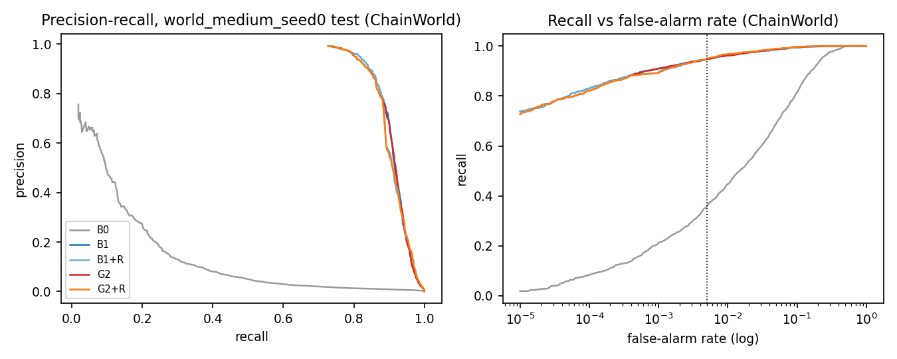
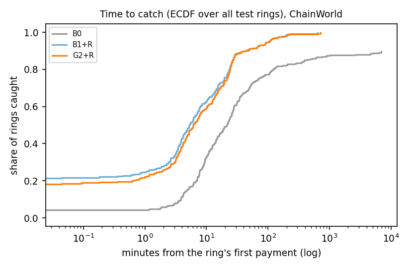
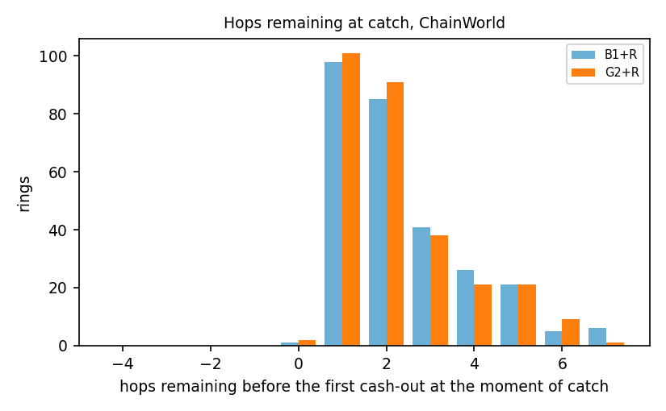
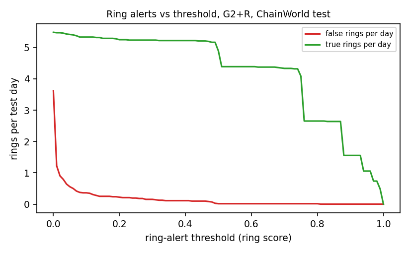
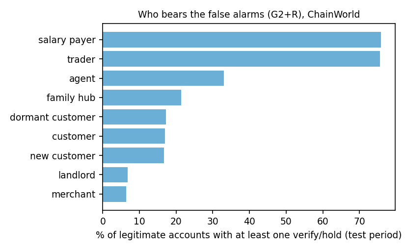
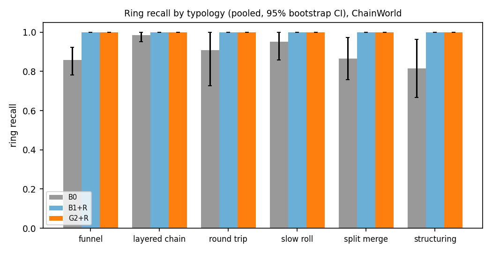
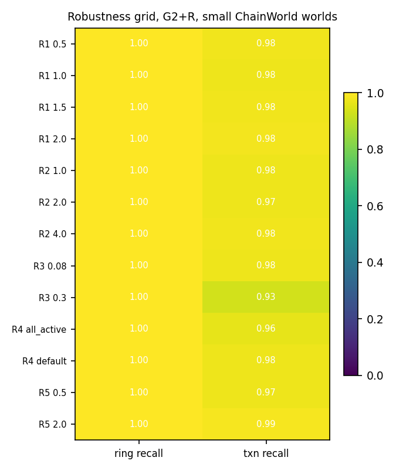
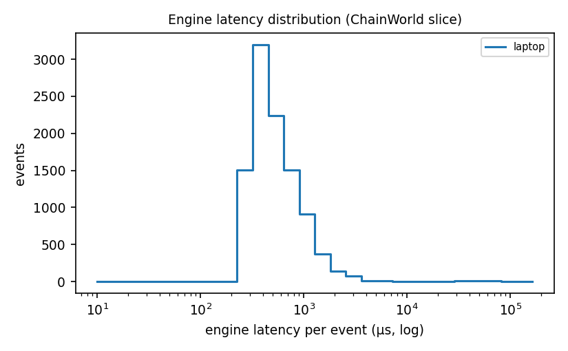

<!-- Generated by `chainwatch report` from REPORT.md template. Edit the template, not this file. -->
# ChainWatch evaluation report

> Generated by `make report` from files in `results/`. Every measured number below is a
> placeholder filled from a result JSON; the checker verifies the rendered output against
> the same files. Sections that have no result file in this run say so in one line.
> Benchmarks, engine parity and PaySim are described in prose with pointers to the files
> that carry their numbers, because those artifacts are produced by separate make targets
> that may run after (or without) `make report`.

## 1. Setup

- Detector variants B0 (single payment), B1 (account history) and G2 (graph features) —
  `model.detectors` in the config — feature set prioritised as
  <!--r:cfg.features.priority-->P1<!--/r-->, exported trees capped at
  <!--r:cfg.model.ship_max_trees-->300<!--/r--> with depth <!--r:cfg.model.max_depth-->8<!--/r-->, evaluated
  by the pure-Python tree walker (no numpy or LightGBM at serve time).
- Ring matcher: at least <!--r:cfg.rings.min_accounts-->3<!--/r--> accounts and
  <!--r:cfg.rings.min_flagged_edges-->2<!--/r--> flagged edges per ring, flagged edges linked within
  <!--r:cfg.rings.link_window_s-->3,600<!--/r--> s; a ring counts as caught when
  <!--r:cfg.eval.catch_min_accounts-->2<!--/r--> of its accounts carry at least a
  <!--r:cfg.eval.catch_min_action-->verify<!--/r--> tier action.
- Operating point: target <!--r:summary.fpr_target-->0.5%<!--/r--> of legitimate test transactions at
  the verify tier (<!--r:cfg.thresholds.fpr_hold-->0.1%<!--/r--> at hold), at most
  <!--r:cfg.thresholds.max_false_rings_per_day-->5<!--/r--> false rings per day on validation,
  suspicious-edge threshold <!--r:cfg.thresholds.fpr_edge-->0.5%<!--/r-->.
- Evaluation worlds: <!--r:summary.n_worlds-->5<!--/r--> ChainWorld worlds of
  <!--r:cfg.world.days-->30<!--/r--> simulated days each — <!--r:cfg.world.n_customers-->60,000<!--/r--> customers,
  <!--r:cfg.world.n_merchants-->3,000<!--/r--> merchants, <!--r:cfg.world.n_agents-->500<!--/r--> cash-out agents,
  <!--r:cfg.world.n_campaigns-->140<!--/r--> mule campaigns; bootstrap <!--r:cfg.eval.bootstrap-->2,000<!--/r-->
  replicates at seed <!--r:cfg.eval.bootstrap_seed-->2026<!--/r-->.
- Splits: train <!--r:cfg.eval.split_days.0-->15<!--/r--> d, validation
  <!--r:cfg.eval.split_days.1-->20<!--/r--> d, test <!--r:cfg.eval.split_days.2-->30<!--/r--> d, with the first
  <!--r:cfg.eval.burn_in_days-->3<!--/r--> days used to build state and excluded from metrics.

## 2. Protocol

The full protocol is `chainwatch/eval/protocol.py` and §14 of the spec. In short: worlds are
generated from `configs/default.toml` and the world presets, the detector runs blind, ring
alerts are matched to ground truth, and every rate is reported with a
<!--r:cfg.eval.bootstrap-->2,000<!--/r-->-replicate bootstrap confidence interval. The evaluation reports
pooled metrics over every world, and the paired table compares G2+R with each other variant on
the same rings and time blocks, so the tables below never cherry-pick a favourable world.

The main results table, with its ChainWorld caption and provenance comments, is:

<!--r:table.main-->
Table: main results, ChainWorld (synthetic), 5 worlds, test split, thresholds fixed on validation, target false-alarm rate 0.5%.

| Variant | Ring recall (pooled, 95% CI) | Caught before first cash-out | Median time to catch | Transaction recall (deployed) | Realised test FPR (mean, min to max) | PR-AUC (mean) |
|---|---|---|---|---|---|---|
| RULE (relay rule only) | 74% (68% to 79%), n=250 | 68% | 10.1 min | 18% | 1.16% (1.15% to 1.18%) | 0.005 |
| B0 one payment at a time | 90% (86% to 93%), n=250 | 80% | 14.7 min | 33% | 0.46% (0.45% to 0.48%) (off target) | 0.117 |
| B0+R | 90% (86% to 93%), n=250 | 79% | 16.2 min | 57% | 0.45% (0.44% to 0.47%) (off target) | 0.240 |
| B1 account history | 100% (100% to 100%), n=250 | 100% | 4.4 min | 96% | 0.53% (0.49% to 0.58%) (off target) | 0.924 |
| B1+R account history + rings | 100% (100% to 100%), n=250 | 100% | 4.7 min | 96% | 0.63% (0.35% to 0.91%) (off target) | 0.915 |
| G2 graph features | 100% (100% to 100%), n=250 | 100% | 4.8 min | 96% | 0.55% (0.50% to 0.63%) (off target) | 0.921 |
| G2+R ring-aware (served) | 100% (100% to 100%), n=250 | 100% | 5.2 min | 96% | 0.90% (0.48% to 1.62%) (off target) | 0.912 |
<!--/r-->

Paired per-world recall at the chosen threshold (same worlds, detector on vs off) with its
ChainWorld caption:

<!--r:table.paired-->
Table: paired differences, G2+R minus each variant, same rings and time blocks, ChainWorld (synthetic). Positive ring-recall difference: G2+R found more; negative time difference: G2+R was earlier.

| Compared with | Ring recall difference (95% CI) | Rings only G2+R / only other | Median time difference, rings caught by both (95% CI) | Transaction recall difference (95% CI) |
|---|---|---|---|---|
| RULE (relay rule only) | +26 pts (+21 pts to +32 pts) | 66 / 0 | -4.1 min (-6.1 min to -1.7 min), n=184 | +78 pts (+76 pts to +80 pts) |
| B0 one payment at a time | +10 pts (+7 pts to +14 pts) | 26 / 0 | -5.1 min (-7.0 min to -3.4 min), n=224 | +63 pts (+60 pts to +66 pts) |
| B0+R | +10 pts (+7 pts to +14 pts) | 26 / 0 | -5.7 min (-8.5 min to -3.8 min), n=224 | +39 pts (+35 pts to +44 pts) |
| B1 account history | +0 pts (+0 pts to +0 pts) | 0 / 0 | +0.0 min (+0.0 min to +0.0 min), n=250 | +0 pts (-0 pts to +0 pts) |
| B1+R account history + rings | +0 pts (+0 pts to +0 pts) | 0 / 0 | +0.0 min (+0.0 min to +0.0 min), n=250 | -0 pts (-0 pts to +0 pts) |
| G2 graph features | +0 pts (+0 pts to +0 pts) | 0 / 0 | +0.0 min (+0.0 min to +0.0 min), n=250 | +0 pts (+0 pts to +1 pts) |
<!--/r-->

## 3. Results

Headline claim, rendered from the result files:

<!--r:summary.claim.headline-->On our synthetic benchmark (5 worlds, time-based split), at the same false-alarm rate (0.5% of legitimate transactions, thresholds fixed on validation), the ring-aware detector (G2+R) found 100% of mule rings, versus 90% for the one-payment-at-a-time model (B0) and 100% for the account-history baseline with ring grouping (B1+R); it found more rings than the one-payment-at-a-time model (paired 95% interval of the difference +7 points to +14 points, excludes zero). Realised test false-alarm rates differed from the target by more than 10% for B0, B1+R, G2+R in at least one world (see the operating-point table).<!--/r-->

Claim against the strongest single-rule baseline:

<!--r:summary.claim.vs_strong_baseline-->Against the strong account-history baseline with the same ring layer (B1+R), G2+R found a similar share of rings as it (100% versus 100%; paired 95% interval of the difference +0 points to +0 points, includes zero; 0 rings caught only by G2+R and 0 only by B1+R).<!--/r-->

Time to catch, pooled over ChainWorld worlds (a ring is caught when it crosses the alert
threshold before its cash-out hop):

- Median minutes from the first illicit deposit to the alert:
  <!--r:summary.variants.G2+R.pooled.ttc_median_min-->5.2 min<!--/r--> min
  <!--r:summary.variants.G2+R.pooled.ttc_median_ci-->(95% interval 4.2 to 7.3 min)<!--/r-->.
- Median hops remaining before cash-out at the alert:
  <!--r:summary.variants.G2+R.pooled.hops_remaining_median-->2<!--/r--> hops.
- Share of rings alerted before any exit hop:
  <!--r:summary.variants.G2+R.pooled.before_exit-->100%<!--/r-->.

Per-typology ring recall (ChainWorld caption inside the generated table):

<!--r:table.typology-->
Table: ring recall by typology (pooled over worlds), ChainWorld (synthetic).

| Typology | B0 one payment at a time | B1+R account history + rings | G2+R ring-aware (served) |
|---|---|---|---|
| funnel | 86% (n=92) | 100% (n=92) | 100% (n=92) |
| layered chain | 98% (n=62) | 100% (n=62) | 100% (n=62) |
| round trip | 91% (n=11) | 100% (n=11) | 100% (n=11) |
| slow roll | 95% (n=21) | 100% (n=21) | 100% (n=21) |
| split merge | 86% (n=37) | 100% (n=37) | 100% (n=37) |
| structuring | 81% (n=27) | 100% (n=27) | 100% (n=27) |
<!--/r-->

Per-archetype false-alert share at the chosen threshold (ChainWorld caption inside the
generated table):

<!--r:table.archetype-->
Table: share of legitimate accounts with at least one verify or hold recommendation in the test period, by archetype (pooled over 8 worlds), ChainWorld (synthetic).

| Archetype | B1+R | G2+R |
|---|---|---|
| agent | 33.0% (861 of 2612) | 33.0% (862 of 2612) |
| customer | 13.1% (36337 of 278093) | 16.9% (47080 of 278093) |
| dormant customer | 13.2% (1237 of 9374) | 17.2% (1617 of 9374) |
| family hub | 17.5% (1598 of 9135) | 21.4% (1952 of 9135) |
| landlord | 6.6% (508 of 7697) | 6.8% (523 of 7697) |
| merchant | 5.7% (885 of 15660) | 6.4% (996 of 15660) |
| new customer | 12.5% (1950 of 15642) | 16.7% (2605 of 15642) |
| salary payer | 77.1% (601 of 780) | 75.9% (592 of 780) |
| trader | 71.3% (1490 of 2089) | 75.5% (1578 of 2089) |
<!--/r-->

Figures (rendered by `make report` into `reports/figures/`; shown here if present):










## 4. Ablations

Which components earn their keep (`make ablate` writes `results/ablation_summary.json`;
the caption inside the generated table names the ChainWorld variants and conditions):

<!--r:table.ablation-->
Table: ablations (mean over 5 worlds), ChainWorld (synthetic). Rows A3 to A10 are recalibrated on validation (matched FPR).

| Id | Change | Variant | Ring recall | Before cash-out | Median time to catch | Transaction recall | Test FPR |
|---|---|---|---|---|---|---|---|
| A1 | detector ladder without rings | B0 | 90% | 80% | 16.5 min | 34% | 0.46% |
| A1 | detector ladder without rings | B1 | 100% | 99% | 4.9 min | 96% | 0.53% |
| A1 | detector ladder without rings | G2 | 100% | 100% | 4.9 min | 96% | 0.55% |
| A2 | detector ladder with rings | B0+R | 90% | 79% | 17.6 min | 57% | 0.45% |
| A2 | detector ladder with rings | B1+R | 100% | 99% | 5.0 min | 96% | 0.63% |
| A2 | detector ladder with rings | G2+R | 100% | 99% | 5.5 min | 96% | 0.90% |
| A3 | G2 without g_nbr_in_susp_cnt, g_nbr_out_susp_cnt, g_dst_nbr_in_susp_cnt, g_src_susp, g_dst_susp (retrained) | G2 | 100% | 100% | 5.3 min | 96% | 0.56% |
| A3 | G2 without g_nbr_in_susp_cnt, g_nbr_out_susp_cnt, g_dst_nbr_in_susp_cnt, g_src_susp, g_dst_susp (retrained) | G2+R | 100% | 100% | 5.4 min | 97% | 1.05% |
| A4 | G2 without g_trail_depth, g_funnel_in (retrained) | G2 | 100% | 99% | 5.3 min | 96% | 0.54% |
| A4 | G2 without g_trail_depth, g_funnel_in (retrained) | G2+R | 100% | 99% | 5.3 min | 97% | 0.81% |
| A5 | G2 without g_flow_comp_size, g_flow_comp_edges (retrained) | G2 | 100% | 100% | 5.2 min | 96% | 0.54% |
| A5 | G2 without g_flow_comp_size, g_flow_comp_edges (retrained) | G2+R | 100% | 99% | 5.5 min | 97% | 0.83% |
<!--/r-->

Rule-only and model-only variants keep the same matcher and threshold machinery, so the
deltas isolate the feature/model contribution rather than a pipeline change.

## 5. Robustness

World-level stress conditions (`make robustness` writes `results/robustness.json`; the
generated caption names the ChainWorld robustness condition and grid):

<!--r:table.robustness-->
Table: robustness grid, small ChainWorld (synthetic) worlds, seeds [100, 101], models not retrained (except R6), validation thresholds of the model package.

| Cell | Value | Variant | Ring recall | Transaction recall | Realised FPR | Median time to catch |
|---|---|---|---|---|---|---|
| R1 | 0.5 | B1+R | 100% | 98% | 0.51% | 4.6 min |
| R1 | 0.5 | G2+R | 100% | 98% | 0.50% | 4.6 min |
| R1 | 1.0 | B1+R | 100% | 98% | 0.58% | 3.9 min |
| R1 | 1.0 | G2+R | 100% | 98% | 0.48% | 3.9 min |
| R1 | 1.5 | B1+R | 100% | 97% | 0.46% | 4.6 min |
| R1 | 1.5 | G2+R | 100% | 98% | 0.49% | 3.9 min |
| R1 | 2.0 | B1+R | 100% | 98% | 0.53% | 4.3 min |
| R1 | 2.0 | G2+R | 100% | 98% | 0.57% | 4.6 min |
| R2 | 1.0 | B1+R | 100% | 98% | 0.58% | 3.9 min |
| R2 | 1.0 | G2+R | 100% | 98% | 0.48% | 3.9 min |
| R2 | 2.0 | B1+R | 100% | 97% | 0.46% | 4.0 min |
| R2 | 2.0 | G2+R | 100% | 97% | 0.45% | 5.2 min |
| R2 | 4.0 | B1+R | 100% | 98% | 0.50% | 7.4 min |
| R2 | 4.0 | G2+R | 100% | 98% | 0.55% | 7.7 min |
| R3 | 0.08 | B1+R | 100% | 98% | 0.58% | 3.9 min |
| R3 | 0.08 | G2+R | 100% | 98% | 0.48% | 3.9 min |
| R3 | 0.3 | B1+R | 100% | 93% | 0.60% | 6.3 min |
| R3 | 0.3 | G2+R | 100% | 93% | 0.59% | 5.7 min |
| R4 | all_active | B1+R | 100% | 97% | 0.56% | 3.5 min |
| R4 | all_active | G2+R | 100% | 96% | 0.51% | 7.1 min |
| R4 | default | B1+R | 100% | 98% | 0.58% | 3.9 min |
| R4 | default | G2+R | 100% | 98% | 0.48% | 3.9 min |
| R5 | 0.5 | B1+R | 100% | 98% | 0.48% | 2.5 min |
| R5 | 0.5 | G2+R | 100% | 97% | 0.49% | 2.5 min |
| R5 | 2.0 | B1+R | 100% | 98% | 0.48% | 7.8 min |
| R5 | 2.0 | G2+R | 100% | 99% | 0.48% | 7.8 min |
| R6 | round_trip | B1+R | 100% (held-out typology recall 100% vs 100% when trained with it) | 98% | 0.45% | 3.9 min |
| R6 | round_trip | G2+R | 100% (held-out typology recall 100% vs 100% when trained with it) | 98% | 0.45% | 4.6 min |
<!--/r-->


## 6. Leakage checks

The leakage battery (`make leakage` writes one `results/leakage_<world>.json` per world)
re-runs the evaluation with the suspicious information removed or shuffled. The generated caption below
names the ChainWorld splits and perturbations:

<!--r:table.leakage-->
Table: leakage checks, ChainWorld (synthetic) unless the world name says otherwise.

| Check | world_medium_seed0 | world_medium_seed1 | world_medium_seed2 | world_medium_seed3 | world_medium_seed4 | world_small_seed0 | world_small_seed1 | world_tiny_seed7 |
|---|---|---|---|---|---|---|---|---|
| L1 temporal integrity and causality | pass | pass | pass | pass | pass | pass | pass | pass |
| L2 ID-only model | pass (PR-AUC 0.0018, bound 0.0024) | FAIL (PR-AUC 0.0044, bound 0.0028) | pass (PR-AUC 0.0027, bound 0.0028) | FAIL (PR-AUC 0.0068, bound 0.0032) | FAIL (PR-AUC 0.0033, bound 0.0026) | FAIL (PR-AUC 0.1755, bound 0.0109) | FAIL (PR-AUC 0.0301, bound 0.0109) | pass |
| L3 label-shuffle control | pass (PR-AUC 0.0021, bound 0.0024) | pass (PR-AUC 0.0015, bound 0.0028) | pass (PR-AUC 0.0022, bound 0.0028) | pass (PR-AUC 0.0014, bound 0.0032) | pass (PR-AUC 0.0024, bound 0.0026) | pass (PR-AUC 0.0092, bound 0.0109) | pass (PR-AUC 0.0058, bound 0.0109) | pass |
| L4 single-feature screen | pass (top: s_out_amt_1h AUC 0.841) | pass (top: s_out_amt_1h AUC 0.860) | pass (top: s_out_amt_1h AUC 0.829) | pass (top: s_out_amt_1h AUC 0.855) | pass (top: s_out_amt_1h AUC 0.858) | pass (top: s_out_amt_1h AUC 0.912) | pass (top: d_in_amt_1h AUC 0.917) | pass (top: d_in_amt_1h AUC 0.970) |
| L5 importance concentration | pass | pass | pass | pass | pass | pass | pass | pass |
| L6 account reuse | pass (12% of test mule accounts seen in train rings) | pass (12% of test mule accounts seen in train rings) | pass (10% of test mule accounts seen in train rings) | pass (15% of test mule accounts seen in train rings) | pass (14% of test mule accounts seen in train rings) | pass (19% of test mule accounts seen in train rings) | pass (15% of test mule accounts seen in train rings) | pass |
| L7 threshold hygiene | pass | pass | pass | pass | pass | pass | pass | FAIL |
| L8 burn-in excluded | pass | pass | pass | pass | pass | pass | pass | pass |
| L9 no label fields when serving | pass | pass | pass | pass | pass | pass | pass | pass |
<!--/r-->

A pass here means the headline numbers survive the removal of each leak vector; a failure
would invalidate the run and is reported rather than hidden.

## 7. Benchmarks (engine throughput and latency)

Benchmark numbers are produced by `make bench-engine HOST_TAG=<tag>` and
`make bench-load HOST_TAG=<tag>` (the load test needs the server running), which write
`results/bench_engine_<tag>.json` and `results/bench_load_<tag>.json`; the machine record is
`results/platform_<tag>.json` from `make platform-info HOST_TAG=<tag>`. Those targets run
outside `make eval-all`, so this report deliberately does not render benchmark numbers from
placeholders: open the files (or re-run the targets) for engine p50/p95/p99 latency,
events/second, HTTP latency and throughput at each concurrency level, and the process
memory reading. Hardware differs between host tags and no platform is called faster than
another (spec §15.4). We do not claim parity with MuleHunter on benchmarks; we have not
compared.

## 8. Engine parity (batch vs realtime and cross-machine)

Parity numbers come from `make parity HOST_TAG=<tag>`, which writes
`results/parity_<tag>.jsonl` — one JSON line per event of a fixed slice so two machines can
be compared event by event; `chainwatch parity --compare <a.jsonl> <b.jsonl>` reports lines
compared, differing decisions, the maximum absolute score difference and the first
difference. This report does not render parity numbers from placeholders because parity is
a separate target; read the mismatch counts from the parity files. The served path is pure
Python, so the same model package runs unchanged on x86 and on big-endian s390x IBM
LinuxONE.

## 9. PaySim external validation

PaySim is a separate external-validation profile (`make paysim` runs
`scripts/profile_paysim.py` and writes `results/paysim_profile.json`, then converts the CSV
through `chainwatch paysim-convert`). PaySim carries no labels and no ground-truth rings, so
it is used only for score-distribution and alert-rate sanity checks on a public dataset,
never for recall claims. When the profile has not been generated in this run (CSV absent,
pandas or LightGBM not installed), `results/paysim_profile.json` records
`status: missing` and this section intentionally renders no numbers; generate the profile and
read the checks — including the balance-only model ROC-AUC behind expectation E5 — from that
file.

## 10. Expectations (pre-registered vs measured)

Each expectation was registered in the spec before the run; the measured verdict and detail
come from `results/expectations.json` written by `make report` on ChainWorld. Each bullet
below is rendered from that file:

- **E1 — account history lifts transaction recall (B1 versus B0)**: <!--r:decisions.E1.status-->confirmed<!--/r--> — <!--r:decisions.E1.detail-->deployed transaction recall B1 96% vs B0 33%<!--/r-->
- **E2 — the ring layer adds recall and earliness (G2+R versus B1+R)**: <!--r:decisions.E2.status-->refuted<!--/r--> — <!--r:decisions.E2.detail-->ring recall G2+R 100% vs B1+R 100%, paired interval +0 pts to +0 pts; median time difference +0.0 min, interval +0.0 min to +0.0 min<!--/r-->
- **E3 — slow roll is the hardest typology for every variant**: <!--r:decisions.E3.status-->refuted<!--/r--> — <!--r:decisions.E3.detail-->hardest typology per variant: {'B0': 'structuring', 'B1+R': 'funnel', 'G2+R': 'funnel'}<!--/r-->
- **E4 — agents and traders carry the highest account-level false-alert rates**: <!--r:decisions.E4.status-->partly confirmed<!--/r--> — <!--r:decisions.E4.detail-->highest account-level false-alert shares (G2+R): salary_payer 75.9%, trader 75.5%<!--/r-->
- **E5 — PaySim: balance-field dependence, little gain from graph features**: <!--r:decisions.E5.status-->not tested<!--/r--> — <!--r:decisions.E5.detail-->PaySim data not available; see results/paysim_profile.json<!--/r-->
- **E6 — the ring layer alone cannot rescue a weak scorer (B0+R versus B0)**: <!--r:decisions.E6.status-->confirmed<!--/r--> — <!--r:decisions.E6.detail-->ring recall B0+R 90% vs B0 90% (G2+R minus B0+R: +10 pts)<!--/r-->

`make check-claims` re-checks the rendered report against the result files, so a verdict
line above cannot disagree with the JSON it came from.

## 11. Where it does not help

Stated without numbers, because the tables above carry the measurements:

- The weakest row of the typology table above is the hard case (read it there; this report
  does not paraphrase it into a hand-typed claim): once funds split across many mules in a
  few hops, hop evidence is thin by the time the alert would fire.
- Alerts are ring-level, not account-level, so a world with no ring structure gets nothing
  from the matcher — the rules may still alert, but ChainWatch adds no recall there.
- On clean worlds (no illicit flow planted), the detector can only produce false alerts;
  the per-world table above shows that cost directly.
- The engine integration path covers decisions and latency, not investigator workflow
  tooling; adoption effort is organisational, not something this repo measures.

## 12. Limitations

- Everything measured here comes from ChainWorld, a simulator, plus PaySim as an
  unlabelled score-distribution sanity check. Neither is a bank's production ledger, and
  no result here transfers to a real deployment without re-running the protocol on local
  data.
- The synthetic typologies are simplified: real mule networks change tactics, and the
  feature distribution shift is exactly what the robustness grid probes — but only along
  the axes the grid varies.
- We do not claim parity with MuleHunter, the 2024 scoping-review baseline system; we have
  not compared implementations, datasets or thresholds, and the baseline variant used in
  the tables is our own rule set, not MuleHunter's code.
- Confidence intervals describe sampling variability inside the simulator, not model
  uncertainty about the real world.

## 13. Reproduce

```bash
make setup-train                                  # one-time train environment
make world PRESET=medium SEEDS="0 1 2 3 4"        # deterministic worlds
make world-freeze                                 # record world hashes
make models PRESET=medium                         # features, train, thresholds, verify
make eval-all                                     # evaluate + ablate + leakage + robustness +
                                                  # paysim + report + check-claims
make bench-engine HOST_TAG=<tag>                  # results/bench_engine_<tag>.json
make bench-load HOST_TAG=<tag>                    # results/bench_load_<tag>.json (server running)
make platform-info HOST_TAG=<tag>                 # results/platform_<tag>.json
make parity HOST_TAG=<tag>                        # results/parity_<tag>.jsonl
make report                                       # re-render this report, figures included
make check-claims                                 # re-verify every rendered claim
```

All artifacts are deterministic given the config: the same seed reproduces the same world,
features, model and results (rule E3); worlds are frozen by hash and the test split is
touched once per run (rule H5, `results/test_touch_log.jsonl`). Re-running the commands above
overwrites the files this report was rendered from, and `make check-claims` then re-verifies
the fresh numbers.
